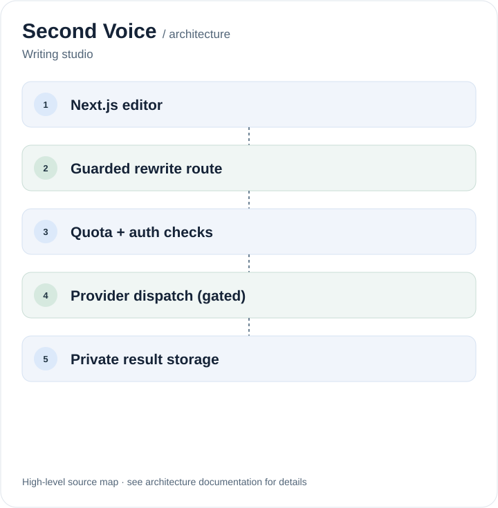

# Second Voice

**Compare your original writing with a rewrite, side by side.**

[Open the writing studio](https://secondvoice.miguelalmeida.xyz/) · [Engineering docs](docs/README.md) · [Release status](docs/security/PORTFOLIO_RELEASE.md)

Second Voice lets a writer explore a different voice, tone or outcome without losing the source draft. The original stays visible beside the rewrite so changes can be reviewed rather than accepted blindly.

## The writing experience

- Choose a voice and mood, then compare the resulting text with the original.
- Keep the source available while reviewing and revising changes.
- Decide explicitly what to save or share; private writing is not automatically published.

**Demo boundary:** The interface can be inspected, but owner-funded AI inference is disabled by default. Enabling live generation requires the documented authentication, abuse-control, provider and financial checks.

## Engineering

The application uses Next.js 16, React 19 and TypeScript. The writing editor lives in `src/components/ghostwriter/`; API routes are in `src/app/`.

A governed server path validates incoming requests before any provider dispatch. Session checks, idempotency and durable quota/budget reservations are separate from the editor. Supabase migrations define the persistence and financial boundaries. The model endpoint and credentials are server-owned.

## Architecture

<p align="center">
  <picture>
    <source media="(max-width: 640px)" srcset="./docs/readme/architecture-mobile.svg">
    
  </picture>
</p>

[AI call graph](docs/security/AI_CALL_GRAPH.md) · [Security and launch gate](docs/security/LAUNCH_GATE.md)

## Run locally

Use Node.js 22 as specified in `.nvmrc`:

```sh
npm ci
npm run dev
```

The UI can run with generation disabled. For configuration, start with [`.env.example`](.env.example); do not use production credentials for local experiments.

```sh
npm run lint
npx tsc --noEmit
npm run security:check
npm run test:unit
npm run test:security
npm run verify:release
```

Locally, `npm run security:check` reads `.env.local` when `NODE_ENV` is not `production`, while preserving values already set in the environment. CI runs `npm run security:check` with explicit production environment variables and AI disabled; production checks do not read `.env.local`.

These commands are verification entry points, not a claim that paid inference is ready. Additional runtime requirements and launch evidence are in the [technical reference](docs/security/TECHNICAL_REFERENCE.md).

Designed and built by [Miguel Almeida](https://github.com/miguelalmeida0).
